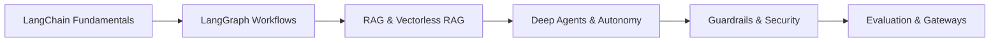

# 🚀 Agentic AI & LangChain: Production Engineering Masterclass

[](https://www.python.org/)
[](https://www.langchain.com/)
[](https://langchain-ai.github.io/langgraph/)
[](https://github.com/astral-sh/uv)
[](LICENSE)

A comprehensive, hands-on guide and practical curriculum for building resilient, enterprise-grade AI systems, multi-agent architectures, and production retrieval pipelines.

---

## 📌 Course Curriculum & Core Modules

This repository systematically walks through foundational LLM programming up to autonomous deep agent systems and production platform engineering.



---

### 1. 🦜🔗 LangChain Fundamentals
- Modern **LangChain 0.3+** standard syntax (`Runnable`, LCEL - LangChain Expression Language).
- Prompt templates, structured outputs (`with_structured_output`), and schema binding.
- Dynamic tool creation, functional calling, and custom integration wrappers.
- Model interoperability across OpenAI, Groq, Google Gemini, and local Ollama instances.

### 2. 🕸️ LangGraph: Agentic Orchestration
- State management with typed schemas (`TypedDict`, Pydantic models).
- Building cyclical multi-step agent flows vs. linear chains.
- Multi-agent architectures (Supervisor, Hierarchical, Collaborative networks).
- Human-in-the-loop (HITL) checkpoints, persistent memory, and time-travel debugging.

### 3. 📚 RAG (Retrieval-Augmented Generation)
- Chunking strategies (semantic, recursive character, document layout-aware).
- Embedding models and vector stores (Chroma, FAISS, Qdrant, Pinecone).
- Advanced retrieval techniques: Hybrid search (Dense + Sparse), Contextual Compression, Parent Document Retrieval, and Re-ranking (Cohere, Cross-Encoders).

### 4. ⚡ Vectorless RAG
- Overcoming semantic drift and high vector compute costs.
- Lexical & keyword search engines (BM25, Elasticsearch, OpenSearch).
- Knowledge Graph RAG (GraphRAG using Neo4j/NetworkX for multi-hop relationship reasoning).
- Structured SQL/Tabular retrieval via Text-to-SQL without vectorization.

### 5. 🧠 Deep Agents
- Autonomous reasoning paradigms (ReAct, Plan-and-Solve, Reflection, Chain-of-Thought).
- Self-correcting coding agents and recursive task decomposers.
- Multi-turn scratchpads and dynamic subagent delegation.
- Long-term memory stores and persistent context synchronization.

### 6. 🛡️ Guardrails & Safety
- Defensive prompting and jailbreak / prompt-injection detection.
- Input and output guardrails with NeMo Guardrails, Guardrails AI, and regex-backed validators.
- PII masking, safety classification, and policy compliance verification.
- Fallback circuits and safe refusal mechanics.

### 7. 📊 LLM Evaluation (Evals)
- Automated benchmarking with **LLM-as-a-Judge**.
- Frameworks: Ragas, TruLens, and DeepEval.
- Core RAG metrics: Faithfulness, Answer Relevance, Context Precision, and Context Recall.
- Synthetic test set generation and CI/CD evaluation pipelines.

### 8. 🚪 LLM Gateways & Production Ops
- Centralized model routing, fallbacks, and failovers across multiple providers.
- Caching layers (semantic caching via Redis/GPTCache) to reduce latency and API bills.
- Rate-limiting, token budgeting, load balancing, and spend telemetry.
- Enterprise gateway frameworks (LiteLLM, Portkey, Cloudflare AI Gateway).

---

## 🗂️ Project Structure

```text
LangChainCourse/
├── langchain/                    # Interactive Jupyter notebooks for experimentation
│   └── 1-langchaininintro.ipynb  # LangChain & LangGraph agent introduction
├── src/                          # Reusable modules and production application code
│   └── langchaincourse/
├── .env.example                  # Template for environment variables and API keys
├── pyproject.toml                # Project metadata and dependencies
├── requirements.txt              # Pip dependency freeze
└── uv.lock                       # Deterministic dependency lockfile
```

---

## 🛠️ Getting Started

### Prerequisites
- Python 3.11+
- [uv](https://docs.astral.sh/uv/) (recommended for 10x faster package installation) or standard `pip`

### 1. Clone the Repository
```bash
git clone https://github.com/<your-username>/LangChainCourse.git
cd LangChainCourse
```

### 2. Set Up the Environment

#### Option A: Using `uv` (Recommended)
```bash
# Create venv and install all dependencies in seconds
uv sync

# Add the Jupyter kernel
uv add ipykernel
```

#### Option B: Using standard Python venv
```bash
python3 -m venv .venv
source .venv/bin/activate  # On Windows: .venv\Scripts\activate
pip install -r requirements.txt
python -m ipykernel install --user --name=langchain-env
```

---

### 3. Configure API Credentials

Create a `.env` file in the root directory:

```bash
cp .env.example .env   # Or create .env manually
```

Add your required API keys:
```env
# Primary LLM Providers
OPENAI_API_KEY="sk-proj-..."
GROQ_API_KEY="gsk_..."
GOOGLE_API_KEY="AQ...."

# Optional RAG & Observability Keys
COHERE_API_KEY=""
LANGCHAIN_API_KEY=""
LANGCHAIN_TRACING_V2="true"
```

---

### 4. Running the Notebooks

1. Open VS Code / your IDE:
   ```bash
   code .
   ```
2. Open [`langchain/1-langchaininintro.ipynb`](langchain/1-langchaininintro.ipynb).
3. Select your `.venv` as the Python Kernel in the top-right corner.
4. Execute cells or click **Run All** (`Ctrl + Option + Cmd + Enter` on Mac).

---

## 🤝 Contributing

Contributions, issues, and feature requests are welcome! Feel free to check the [issues page](https://github.com/<your-username>/LangChainCourse/issues).

---

## 📄 License

Distributed under the MIT License. See `LICENSE` for more information.

